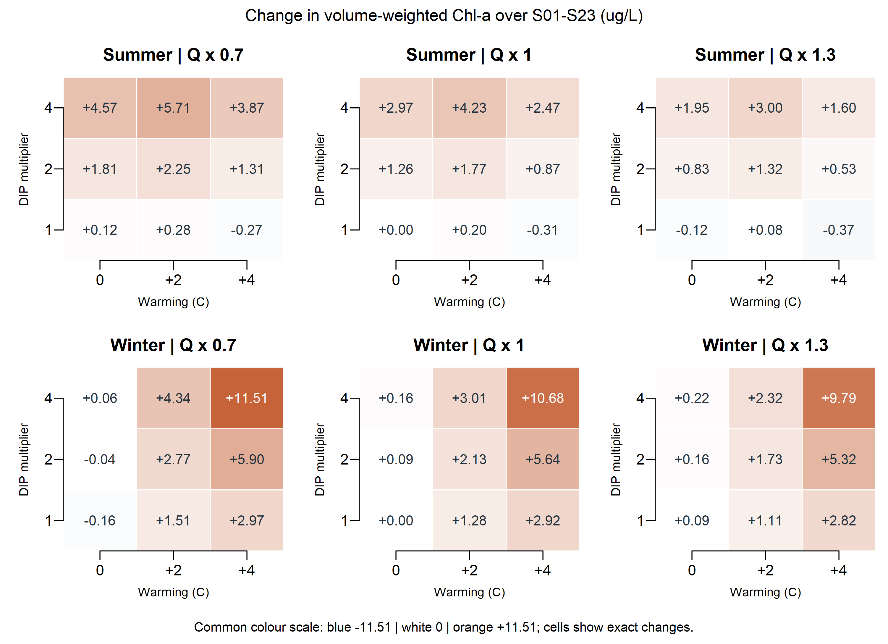

# 南水北调中线 WASP8 季节模型与全球变化情景研究

本项目围绕夏季和冬季的藻类响应差异，完成数据整理、两套季节模型的空间率定检验，以及升温、增磷与流量变化的全因子情景模拟。建议先阅读 `05_report/南水北调中线WASP8_季节率定与情景汇报.docx`，参数和复现细节见同目录的 `补充材料_WASP8季节模型参数与复现说明.docx`。

提交文件：[主报告 PDF](05_report/南水北调中线WASP8_季节率定与情景汇报.pdf) · [主报告 Word](05_report/南水北调中线WASP8_季节率定与情景汇报.docx) · [参数附录 PDF](05_report/补充材料_WASP8季节模型参数与复现说明.pdf)。数据来源与公开范围见 [DATA_SOURCES.md](DATA_SOURCES.md)。

快速核查保存的计算结果（无需 WASP8）：

```powershell
python 06_复现脚本/reproduce.py check
```

重建图表和汇报：先安装 `requirements.txt` 中的 Python 依赖及 R，再运行 `python 06_复现脚本/reproduce.py report`。完整重算使用 `full` 模式，需本机 WASP8。详细命令见 [脚本说明](06_复现脚本/README.md)。

季节命名约定为 `2020-08` 对应夏季（Summer），`2021-03` 对应冬季（Winter）。两季采用各自的观测、入口和率定参数；每季分别用空间区间留出检验。采样月份保留原始记录。文献图像保留原貌，其 Chl-a 散点估读值用于课程级条件性率定。

## 研究设计与核心结论

模型包含 29 个等效渠段，以站 04—26 对应的 S01—S23 为主要比较范围。两季分别执行 18 组参数试算，冬季另有 3 组入口敏感性试算。每季最终工程运行 27 个温度×DIP×流量组合，共 54 个情景。

以下结果为 S01—S23 体积加权 Chl-a 相对各季自身基准的变化。

| 情景 | 夏季变化 | 冬季变化 |
|---|---:|---:|
| 单独升温 4°C | −5.3% | +44.3% |
| 单独 DIP×4 | +51.1% | +2.4% |
| 升温 4°C、DIP×4、流量×0.7 | +66.6% | +174.7% |

冬季主要体现升温与增磷的正交互，夏季主要体现增磷与低流量的正交互。强联合情景超过三个单因素增量之和的部分，夏季为 1.09 µg/L，冬季为 8.59 µg/L。讨论结合温度曲线、呼吸损失、残余 DIP 和入口浓度解释这种差异，并据此提出按季节和复合工况安排监测的建议。

模型仍难以重现局部观测起伏，冬季入口 Chl-a 7 µg/L 与 N:C 0.10 为探索性假设。参数方案参考总体数据，空间四折评分属于条件性检验。季节差异同时包含参数、入口和工况影响；Q 情景固定入口浓度，因此负荷随流量改变。输出为固定 90 日末值，不能直接解释为真实藻华概率或调度阈值。

## 文件导航

| 目录 | 内容 |
|---|---|
| `01_模型输入` | 渠网、流量、水质、图像估读、固定四折划分及完整显式参数总表 |
| `02_中间输出/06_季节独立率定` | 36 个参数候选、3 个入口探索工程和两套最终工程，包含 WIF、结果和日志 |
| `02_中间输出/07_季节三因素情景` | 两季各 27 个温度×DIP×流量情景工程 |
| `03_最终结果/01_率定与检验` | 逐折选参、逐站预测、最终拟合和误差指标 |
| `03_最终结果/04_季节情景与交互` | 54 行情景汇总、1566 条逐段输出、464 条交互分解、数值核验和机制诊断 |
| `04_figures` | 图 1 空间率定、图 2 全因子响应、图 3 交互分解，提供 PNG/PDF/SVG |
| `05_report` | 主报告、参数复现附录和参数／情景索引表 |
| `06_复现脚本` | 求解、核验、诊断、绘图及报告脚本，含运行依赖、基础 WIF 与参数命令记录 |
| `chart_data` | 三张图的配套绘图数据及渠段、流量表 |
| `07_核查记录` | 从原始求解输出重算的报告统计、数值一致性检查与提交核查说明 |

`01_模型输入/共用参数参考/补充材料_WASP8季节模型完整参数总表.csv` 汇总几何、流量、最终边界与初值、动力学常数、时间函数、分段参数和情景输入。该表根据本项目保存的输入及命令生成。完整内部设置由最终 WIF 保留，参数总表同时包含初始化占位项，不代表每个过程均启用。运行所需的处理后数据与基础工程已包含在项目中；原始文献与图像的出处见 DATA_SOURCES.md。

## 复现步骤

以**项目根目录**为工作目录。结果核查仅需 Python 3.12；生成 Word 需 python-docx，绘图需 R。WASP8 仅用于重新求解，默认路径为 `D:\APP\USEPA-WASP8\wasp\bin`，其他电脑可设置 `WASP_BIN`。以下 Python 脚本均位于 `06_复现脚本`。

1. 执行 `fit_seasons_spatial_cv.py`，完成两季参数网格与固定空间四折评分。
2. 执行 `run_winter_inlet_candidates.py` 与 `score_winter_inlet_exploration.py`，完成冬季入口探索及评分。
3. 执行 `package_seasonal_models.py`，汇集最终季节工程及参数索引。
4. 执行 `run_seasonal_scenarios.py` 与 `verify_seasonal_scenarios.py`。只有基础 WIF、命令和成功输出匹配时复用缓存，修改输入会触发重算；`WASP_FORCE=1` 可强制重算情景。
5. 执行 `build_parameter_appendix.py`，生成完整参数总表与复现附录；执行 `diagnose_seasonal_mechanisms.py`，生成温度项和残余磷诊断。
6. 执行 `sync_chart_data.py` 同步绘图数据，再执行 `audit_project.py` 核对原始输出、结果表与绘图表。执行两份 `plot_seasonal_*.R` 重绘三张图。
7. 执行 `build_submission_report.py` 生成主报告。`render_word.ps1` 接收报告文件名并导出 PDF。`refresh_manifest.py` 更新文件清单及 SHA-256。上述核查与生成步骤可由 `reproduce.py report` 一次执行。

参数溯源命令用于核对设置来源；实际重算以随附基础 WIF 为起点。检查计算成果时，应同时核对求解器闭合日志、状态量完整性、营养盐质量平衡和末日 Chl-a 变化。所有文件的完整性以 `文件清单与校验值.csv` 为准。


